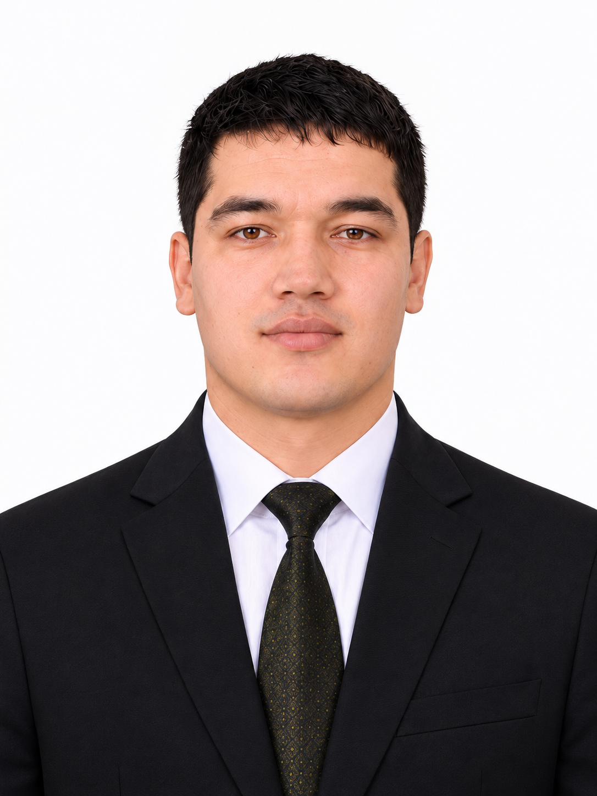

# Sayfiyev Hasan Olim o‘g‘li

**Elektronika va mikrokontroller tizimlari muhandisi · Doktorant tadqiqotchi**

I am an assistant lecturer at Bukhara State Technical University and a PhD researcher working on monitoring and diagnostics of photovoltaic systems. I work with electronic devices, microcontrollers and sensors, and design multilayer PCBs using EasyEDA Pro. My online username is usta_hasan.

[Batafsil tarjimayi hol](https://github.com/usta-hasan/engineering-portfolio/blob/main/ABOUT.md) · [Loyihalar](https://github.com/usta-hasan/engineering-portfolio) · [Wikipedia foydalanuvchi sahifam](https://uz.wikipedia.org/wiki/Foydalanuvchi:Sayfiyev_Hasan)

## Ta’lim

| Davr | Yo‘nalish | Ta’lim muassasasi |
|---|---|---|
| 2015–2019 | Elektr texnikasi, elektr mexanikasi va elektr texnologiyalari — bakalavr | Buxoro muhandislik-texnologiya instituti |
| 2019–2021 | Texnologik jarayonlarni boshqarishning axborot-kommunikatsiya tizimlari — magistr | Buxoro muhandislik-texnologiya instituti |
| 2022-yildan | Qayta tiklanuvchi energiya qurilmalari — doktorantura tadqiqoti | Buxoro |

## Ish faoliyati

- **2025-yil aprelidan:** Buxoro davlat texnika universiteti, assistent.
- **2022–2025:** Buxoro muhandislik-texnologiya instituti, stajyor o‘qituvchi va assistent. Ish davrlari: 09.2022–07.2023 va 09.2023–04.2025.
- **2020–2021:** ARK EKO TEKSTIL, elektrik.

## Muhandislik ishlarim

| Ish | Texnik mazmun |
|---|---|
| [Fotoelektrik monitoring](https://github.com/usta-hasan/engineering-portfolio/tree/main/projects/pv-monitoring) | Modul, string va markaziy kontroller orqali o‘lchash; kuchlanish, tok, harorat va yoritilish |
| [PCB loyihalash](https://github.com/usta-hasan/engineering-portfolio/tree/main/projects/pcb-design) | EasyEDA Pro; buyurtma asosida ikki va undan ortiq qatlamli platalar; bir qatlamli PCB uchun 3D printerdan foydalanish |
| [Zakovat qurilmasi](https://github.com/usta-hasan/engineering-portfolio/tree/main/projects/zakovat) | Arduino Nano, PC817 va MOSFET asosidagi elektron plata |
| [Quyosh trekeri](https://github.com/usta-hasan/engineering-portfolio/tree/main/projects/solar-tracker) | Ikki o‘qli qo‘lda boshqaruv; rele, limit va revers blokirovkasi |
| [Suv monitoringi](https://github.com/usta-hasan/engineering-portfolio/tree/main/projects/water-flow) | Master va uchta sensor tuguni, ultratovush sensorlari va I²C |
| [Arduino va Delphi](https://github.com/usta-hasan/engineering-portfolio/tree/main/projects/aeration-demo) | JSON/serial orqali to‘rtta motor kanalini boshqarish demonstratori |
| [Office Imlo](https://github.com/usta-hasan/Office-Imlo) | Office uchun o‘zbekcha matn, lotin/kiril va Word kitobcha hisoblagichi |

## Texnologiyalar

**Qurilmalar:** Arduino Nano/Mega, ATtiny85, sensorlar, analog o‘lchash zanjirlari, rele va motor boshqaruvi.  
**Dasturlash:** C/C++, Delphi/Object Pascal, C#, VBA.  
**Aloqa:** I²C, UART, RS-485, Modbus RTU.  
**Muhitlar:** EasyEDA Pro, Arduino IDE, Delphi, MATLAB/Simulink, Microsoft Office COM.

## Ilmiy faoliyat

Mavzuim: **Fotoelektrik batareyalarining energetik parametrlarini monitoring va diagnostika tizimini ishlab chiqish**. OAK ro‘yxati: B2024.1.PhD/T4467. Ilmiy rahbarim: Maxmudov Maxsud Idrisovich.

- [2021–2026-yillardagi 16 ta nashr](https://github.com/usta-hasan/engineering-portfolio/blob/main/PUBLICATIONS.md): 6 jurnal va 10 konferensiya materiali.
- Fotoelektrik monitoring bo‘yicha ikki obyektning joriy etish dalolatnomasi — 20.10.2025.
- DGU 27454 va DGU 27455 dastur guvohnomalari huquq egasi — 13.09.2023.
- Elektr muhandisligi bo‘yicha 288 soat malaka oshirish — 2026-yil.

## Aloqa

Buxoro, O‘zbekiston · [Email](mailto:hasansoftware6451122@gmail.com) · [Telegram](https://t.me/usra_hasan)

### English

I am an electronics and embedded systems engineer and doctoral researcher in Bukhara, Uzbekistan. I work on photovoltaic monitoring, PCB design, sensor acquisition and microcontroller control. My projects combine C/C++ firmware, Delphi desktop applications and C#/VBA integration with Microsoft Office.
